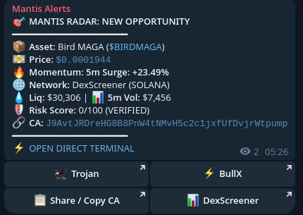

# ⚡ Mantis Crypto Radar

<p align="center">
  
  
  
  
</p>

A high-performance, asynchronous on-chain token scanner engineered for **Solana** and **Base** ecosystems. Mantis identifies newly surfaced token pairs, filters them through real-time liquidity/volume thresholds, executes an automated risk assessment pipeline, and dispatches actionable trade signals to Telegram with direct execution terminals.

<p align="center">
  
</p>

---

## 🚀 Key Features

- **Dual-Chain Parallel Ingestion:** Concurrent scanning across Solana and Base using `httpx` connection pooling and `asyncio.gather`.
- **Multi-Layer Security Pipeline:** Automated contract security checks via RugCheck and GoPlus APIs (flags mint authority, freeze authority, honeypots, and top-holder concentration).
- **Persistent Deduplication:** SQLite state machine running in WAL mode to eliminate redundant alerts across restarts.
- **Smart Rate Limiting:** Concurrency control with `asyncio.Semaphore`, proactive 429 backoff handling, and jittered retries.
- **Instant Execution UX:** Telegram notifications formatted with instant trading action buttons (Trojan Bot, BullX Terminal, DexScreener, and CA copy).
- **System Telemetry:** Automated hourly diagnostic reporting tracking scanned pools, filtered volume, blocked rugs, and engine uptime.

---

## 🛠️ Architecture

```text
DexScreener Feeds ───► Concurrency Control (Semaphore)
                             │
                             ▼
                    Liquidity & Vol Filter
                             │
                             ▼
                  Security Engine (RugCheck / GoPlus)
                             │
              ┌──────────────┴──────────────┐
              ▼                             ▼
       [Risk Score > 30]             [Risk Score <= 30]
         Dropped (Rug)                      │
                                            ▼
                                  SQLite Deduplication
                                            │
                                            ▼
                                   Telegram Dispatcher
```

---

## 📦 Getting Started

### Prerequisites

* Python 3.10+
* Node.js & PM2 (for 24/7 background deployment)
* Linux / VPS environment

### Installation

1. **Clone the repository:**

```bash
git clone [https://github.com/Manteos35/mantis.git](https://github.com/Manteos35/mantis.git)
cd mantis

```

2. **Set up the virtual environment:**

```bash
python3 -m venv venv
source venv/bin/activate
pip install -r requirements.txt

```

3. **Configure Environment Variables:**

```bash
cp .env.example .env
micro .env

```

Fill in your credentials:

```env
TELEGRAM_BOT_TOKEN="your_bot_token_here"
TELEGRAM_CHAT_ID="your_channel_or_chat_id_here"

```

4. **Run the Engine:**

* **Development / Testing:**

```bash
python3 hunter.py

```

* **Production (PM2):**

```bash
pm2 start hunter.py --name "mantis-radar" --interpreter ./venv/bin/python3
pm2 save
pm2 startup

```

---

## 🛡️ Security Verification Matrix

| Check | Solana Mechanism | EVM / Base Mechanism | Threshold |
| --- | --- | --- | --- |
| **Mint Authority** | Token Program Metadata | Contract `owner()` / Mint Function | Must be Revoked |
| **Freeze Authority** | Token Program Freeze Key | Contract Freeze Functions | Must be Revoked |
| **Liquidity Lock** | LP Burn / Raydium Vault State | DEX Pair LP Token Balance | Minimum 80% Locked |
| **Concentration** | Top 10 Holder Balances | Top 10 Holder Balances | < 40% Cumulative Supply |
| **Tradeability** | On-Chain Simulation | GoPlus Honeypot Detection | Zero Honeypot Risk |

---

## ⚠️ Disclaimer

This software is intended for informational and analytical purposes only. Cryptocurrency trading involves substantial financial risk. Perform your own due diligence before executing trades.
